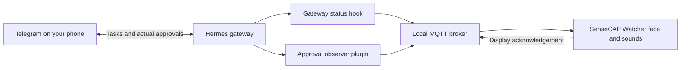

# Hermes Watcher

A small physical companion for [Hermes Agent](https://github.com/NousResearch/hermes-agent),
running on the [SenseCAP Watcher](https://github.com/Seeed-Studio/SenseCAP-Watcher-Firmware).

The Watcher shows a translucent animated face while Hermes works, plays short
sound cues, and draws attention to permission requests and questions. Answer
the original request in Telegram; the Watcher does not approve commands itself.

This repository contains an integration patch and selected source files, not a
complete device image. Your own Watcher's factory data stays on your device.

## What it does

- Circular face with gentle movement, blinking, and state-dependent expressions.
- Quiet smiling idle state; closed eyes and a drifting Z when offline.
- Different colors for thinking, searching, working, success, and errors.
- Translucent, non-clickable overlay that leaves native touch controls available.
- Persistent amber alerts for permissions and Telegram choice questions.
- Seven short, locally embedded CC0 sound cues; no audio download at runtime.
- MQTT request IDs and display acknowledgements for troubleshooting.



## Start here

```bash
git clone https://github.com/chaudharysk/hermes-sensecap-watcher.git hermes-watcher-public
cd hermes-watcher-public
```

1. [Follow the complete tutorial](docs/TUTORIAL.md): broker, firmware, laptop,
   Telegram, and an end-to-end check.
2. [Read the MQTT protocol](docs/PROTOCOL.md) if integrating another sender.
3. [Troubleshoot missing alerts](docs/TROUBLESHOOTING.md).
4. [Review what is safe to publish](docs/PRIVACY.md).
5. [Publish this prepared project to GitHub](docs/PUBLISHING.md).

## Repository layout

| Location | Purpose |
| --- | --- |
| `firmware/integration.patch` | Small changes to the pinned upstream firmware |
| `firmware/overlay/` | Hermes C sources, example configuration, and audio |
| `firmware/upstream.json` | Exact public upstream revision |
| `laptop/watcher-approval/` | Real permission/clarification observer plugin |
| `laptop/watcher-status/` | Generic gateway activity publisher |
| `laptop/diagnose.py` | Readable checks of the actual MQTT/display path |
| `broker/` | Example local Mosquitto deployment |
| `tools/` | Safe patch application and release checks |

## Compatibility and validation

The original working device setup was reported working by its owner. This public
package sanitizes connection settings and adds installation materials; it has
**not** been firmware-built, flashed, or tested on additional hardware as part of
release preparation. Python tests and patch-application checks are separate from
hardware validation. See [validation notes](docs/VALIDATION.md).

The patch targets public upstream commit
`8e37f7ccd3d836bb99f483e0f6e74e8252406644`. The corresponding factory-firmware
installation guide specifies ESP-IDF **v5.2.1**. Other versions are not promised
to work. Hermes must expose a supported approval hook pair; clarification
questions additionally require its human-input hooks. The installer does not
upgrade Hermes or alter approval policy.

The face keeps the display awake. Native controls remain available, but the
overlay occupies screen space and pending alerts move to the foreground. This
uses more power than allowing the normal screensaver. Sounds use the Watcher's
audio player and volume; busy voice/audio activity can delay or suppress cues.

## Development

From this repository root, using Python 3.11 or newer:

```bash
python -B -m unittest discover -s laptop/tests -v
python -B -m unittest discover -s tests -v
python -B tools/check_release.py
```

These commands do not contact a real broker, build firmware, or flash hardware.
The example broker/tutorial is intended for a trusted private LAN. It does not
provide encrypted MQTT or a public internet approval service.

## License and credits

Code and documentation: [Apache-2.0](LICENSE). The integration builds on Seeed
Studio's Apache-2.0 firmware. Sounds: [Kenney Interface Sounds](https://kenney.nl/assets/interface-sounds),
CC0-1.0. See [NOTICE](NOTICE) and the original audio license. This is an
independent community project, not an official Seeed Studio or Nous Research product.
