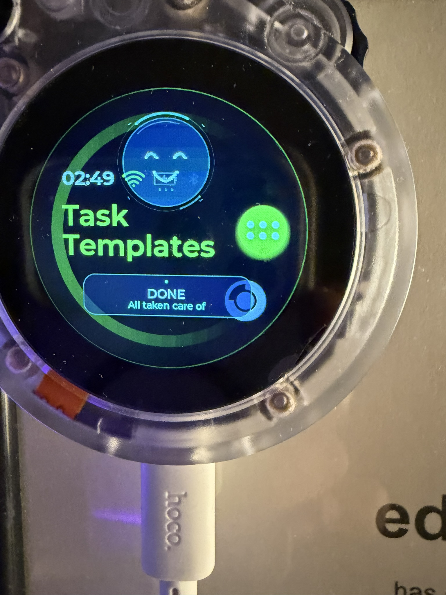

# Use SenseCAP Watcher as a Hermes Status Display

**Hermes runs on your computer. The Watcher shows what Hermes is doing.**

This guide installs a status-display integration on your SenseCAP Watcher.
It receives messages from Hermes and shows an animated face, task updates,
short sounds, and permission/question alerts. It does not install Hermes or
an AI model on the Watcher.

**It works through Hermes events, not a Telegram connection.** Use your preferred
supported Hermes gateway channel. Answer requests in the same chat or terminal
where Hermes asked them. The Watcher displays the alert; it does not approve it.

<p align="center">
  
</p>

## Installation at a glance

| Part | Where it goes | What it does |
| --- | --- | --- |
| MQTT broker | Linux computer running Hermes | Passes small messages to the Watcher |
| Hermes plugin and status hook | That computer's Hermes profile | Sends task updates and requests |
| Firmware integration | SenseCAP Watcher, installed over USB | Draws the face and plays sounds |

You can do everything on one Linux computer. If you build firmware on Windows,
keep the broker and Hermes senders on Linux and use the Windows alternative in
step 4. The computer running the broker must stay on while you use the display.

1. [Check what you need](#1-what-you-need).
2. [Download the project](#2-download-the-project).
3. [Start the broker](#3-set-up-the-broker-on-the-linux-laptop).
4. [Prepare and configure the firmware](#4-prepare-the-watcher-firmware).
5. [Install it over USB](#5-install-on-the-sensecap-watcher).
6. [Connect Hermes](#6-install-the-hermes-senders).
7. [Try it](#7-test-the-display-and-a-real-task).

Already have a working Hermes Watcher? You do not need to reinstall it just to
follow this guide. Keep your existing broker, private settings, and working app.

## 1. What you need

- A SenseCAP Watcher already set up with your own SenseCraft account and Wi-Fi.
  Confirm that its normal features work before changing firmware.
- A USB **data** cable.
- A Linux computer running Hermes. Confirm that you can already send it a task
  through your chosen chat channel. See the [Hermes documentation](https://hermes-agent.nousresearch.com/docs/).
- Git, Python 3.11 or newer, Docker Engine, and the Docker Compose plugin.
- ESP-IDF **v5.2.1** on the computer that will build the firmware.
- Watcher and broker computer on the same trusted local network.

In a normal Linux terminal, check your tools:

```bash
git --version
python3 --version
hermes --version
docker --version
docker compose version
docker ps
```

Fix missing tools before continuing. For Docker, follow the
[official installation guide](https://docs.docker.com/engine/install/ubuntu/)
and its Linux access instructions. On Linux Mint, use the underlying Ubuntu
release as documented; Docker does not officially support Ubuntu derivatives.
The Hermes account must be able to run `/usr/bin/docker` without an interactive
sudo prompt. Docker access grants powerful host privileges.

## 2. Download the project

**Run on the Linux computer that runs Hermes:**

```bash
mkdir -p "$HOME/hermes-watcher-setup"
cd "$HOME/hermes-watcher-setup"
git clone https://github.com/chaudharysk/hermes-sensecap-watcher.git hermes-watcher-public
```

The commands below use this folder consistently. If it already exists, use your
existing checkout instead of cloning over it.

## 3. Set up the broker on the Linux laptop

MQTT is the small message service between Hermes and the Watcher.

**Already have `hermes-mqtt` working?** Keep it. Skip creation below and use its
address and credentials in step 4. The supplied senders publish using
`docker exec hermes-mqtt` to `127.0.0.1:1883` **inside the container**. Your existing
broker must support that connection or the senders must be adapted.

For a **new** broker, find your computer's LAN address:

```bash
hostname -I
```

Choose its Wi-Fi/Ethernet address, not a Docker or VPN address. Reserve that
address in your router so it does not change.

```bash
cd "$HOME/hermes-watcher-setup/hermes-watcher-public/broker"
cp .env.example .env
nano .env
```

Replace the example address after `WATCHER_LAN_IP=` with your computer's real
LAN address. In nano: **Ctrl+O**, **Enter** to save, then **Ctrl+X** to exit.

Create a password for the Watcher and start the broker:

```bash
docker compose run --rm --user root broker mosquitto_passwd -c /mosquitto/secrets/passwords watcher
docker compose run --rm --user root broker sh -c 'chown 1883:1883 /mosquitto/secrets/passwords && chmod 600 /mosquitto/secrets/passwords'
docker compose up -d
docker compose ps
```

The password command asks you to type the new password twice. Keep it for
step 4. Use `-c` only for a new password file: it replaces an existing file.
The service should show as running.

Check that the local publisher works:

```bash
docker exec hermes-mqtt mosquitto_pub -h 127.0.0.1 -t hermes/status -m ONLINE -q 1 -r
```

**Expected:** it exits without an error. No Watcher change is expected until
firmware installation is complete.

The Watcher connects to the computer's port **1883** with username `watcher` and
your password. The broker maps this to its authenticated container listener.
Keep this plaintext MQTT service on your trusted LAN; do not forward it through
your router. See [broker details](../broker/README.md) for listener and access rules.

## 4. Prepare the Watcher firmware

### Linux: install the build tools once

If ESP-IDF v5.2.1 is already installed, activate that installation and skip its
clone/install commands. Otherwise, on Ubuntu/Linux Mint:

```bash
sudo apt-get update
sudo apt-get install git wget flex bison gperf python3 python3-pip python3-venv cmake ninja-build ccache libffi-dev libssl-dev dfu-util libusb-1.0-0 build-essential
mkdir -p "$HOME/esp"
cd "$HOME/esp"
git clone -b v5.2.1 --recursive https://github.com/espressif/esp-idf.git esp-idf-v5.2.1
cd esp-idf-v5.2.1
./install.sh esp32s3
. ./export.sh
idf.py --version
```

**Expected:** ESP-IDF v5.2.1. In a new build terminal, activate it again with:

```bash
. "$HOME/esp/esp-idf-v5.2.1/export.sh"
```

These steps follow [Espressif's v5.2.1 setup guide](https://docs.espressif.com/projects/esp-idf/en/v5.2.1/esp32s3/get-started/linux-macos-setup.html).
Keep using a normal, separate terminal for Hermes commands if Hermes uses its own Python environment.

### Linux: download the matching firmware and apply this integration

```bash
cd "$HOME/hermes-watcher-setup"
git clone https://github.com/Seeed-Studio/SenseCAP-Watcher-Firmware.git SenseCAP-Watcher-Firmware-public
cd SenseCAP-Watcher-Firmware-public
git checkout 8e37f7ccd3d836bb99f483e0f6e74e8252406644
git submodule update --init --recursive components/rlottie/rlottie
cd ..
python3 hermes-watcher-public/tools/apply_firmware.py SenseCAP-Watcher-Firmware-public --check
python3 hermes-watcher-public/tools/apply_firmware.py SenseCAP-Watcher-Firmware-public
```

**Expected:** `Integration applied`. The installer creates a private settings
file. It refuses a modified or mismatched checkout; use a fresh folder rather
than forcing changes into your working firmware.

```bash
nano "$HOME/hermes-watcher-setup/SenseCAP-Watcher-Firmware-public/examples/factory_firmware/main/app/hermes_config.h"
```

Set these three values:

```c
#define HERMES_MQTT_URI "mqtt://YOUR_LAPTOP_LAN_IP:1883"
#define HERMES_MQTT_USERNAME "watcher"
#define HERMES_MQTT_PASSWORD "YOUR_MQTT_PASSWORD"
```

Replace both placeholders with your own values. Use the same computer address
as step 3, not `localhost`. Escape quotes and backslashes if your password
contains them (`\"` and `\\`). Save the file.

This file is Git-ignored. It and the compiled app contain your broker settings;
keep them private. No chat-service token or model API key belongs in this file.

Build:

```bash
cd "$HOME/hermes-watcher-setup/SenseCAP-Watcher-Firmware-public/examples/factory_firmware"
idf.py set-target esp32s3
idf.py build
```

**Expected:** `Project build complete`. Stop and resolve errors if the build
fails. This command does not install anything on the Watcher.

### Windows alternative for the firmware steps

Keep steps 2, 3, and 6 on your Linux Hermes computer. On Windows, install
[ESP-IDF v5.2.1 for ESP32-S3](https://docs.espressif.com/projects/esp-idf/en/v5.2.1/esp32s3/get-started/windows-setup.html)
and open its **ESP-IDF PowerShell** terminal. Use a new folder without spaces:

```powershell
New-Item -ItemType Directory -Force C:\hermes-watcher-setup
Set-Location C:\hermes-watcher-setup
git clone https://github.com/chaudharysk/hermes-sensecap-watcher.git hermes-watcher-public
git clone https://github.com/Seeed-Studio/SenseCAP-Watcher-Firmware.git SenseCAP-Watcher-Firmware-public
Set-Location SenseCAP-Watcher-Firmware-public
git checkout 8e37f7ccd3d836bb99f483e0f6e74e8252406644
git submodule update --init --recursive components/rlottie/rlottie
Set-Location ..
python hermes-watcher-public/tools/apply_firmware.py SenseCAP-Watcher-Firmware-public --check
python hermes-watcher-public/tools/apply_firmware.py SenseCAP-Watcher-Firmware-public
notepad SenseCAP-Watcher-Firmware-public\examples\factory_firmware\main\app\hermes_config.h
```

Enter the **Linux broker computer's** address and password as above. Save and
close Notepad, then build:

```powershell
Set-Location C:\hermes-watcher-setup\SenseCAP-Watcher-Firmware-public\examples\factory_firmware
idf.py --version
idf.py set-target esp32s3
idf.py build
```

## 5. Install on the SenseCAP Watcher

**Run from `examples/factory_firmware` in your activated ESP-IDF terminal.**

Connect the cable to the Watcher's **bottom/side USB data port**. Its back USB
port is power-only. Two serial ports may appear; select the ESP32-S3 port.
These hardware details and the backup procedure are in
[Seeed's installation guide](https://github.com/Seeed-Studio/SenseCAP-Watcher-Firmware/blob/8e37f7ccd3d836bb99f483e0f6e74e8252406644/examples/factory_firmware/docs/installation.md).

List ports:

```bash
python -m serial.tools.list_ports
```

On Windows, Device Manager's **Ports (COM & LPT)** also lists them. Check a port
with `idf.py -p YOUR_PORT monitor`; ESP32 boot/app logs identify the correct
one. **Ctrl+]** exits the monitor. Replace `YOUR_PORT` in all commands below.

### Back up your device's factory data first

Keep your current working firmware/build configuration privately for rollback.
The device's `nvsfactory` partition contains its own provisioning data.

Verify that your installed partition layout matches the pinned factory-firmware
project before app-only flashing. Seeed documents `nvsfactory` at `0x9000`, size
`204800` bytes for this layout. **Only when your device matches that layout**,
read it to a private folder outside the repositories:

```bash
# Linux: choose a new backup filename if you have already made one
mkdir -p "$HOME/watcher-private-backups"
esptool.py --port YOUR_PORT --chip esp32s3 --no-stub read_flash 0x9000 204800 "$HOME/watcher-private-backups/nvsfactory.bin"
```

```powershell
# Windows alternative
New-Item -ItemType Directory -Force C:\watcher-private-backups
esptool.py --port YOUR_PORT --chip esp32s3 --no-stub read_flash 0x9000 204800 C:\watcher-private-backups\nvsfactory.bin
```

Check that the read succeeded and the file is 204800 bytes. If your layout is
different or unknown, stop and follow the matching Seeed firmware/recovery
instructions. Never upload this backup or replace it with another person's data.

### Flash the app only

Use your actual ESP32 port. These are alternatives:

```powershell
# Windows example: replace COM_PORT
idf.py -p COM_PORT app-flash
```

```bash
# Linux example: replace the port if yours differs
idf.py -p /dev/ttyACM0 app-flash
```

Use **`app-flash`**, not `flash` or `erase-flash`. This project supplies no factory
data, partition table, camera model, or filesystem image. The short sounds are
embedded in the app and need no separate flash step.

After reboot, confirm that the normal Watcher interface and Wi-Fi still work.
The Hermes face should appear. It may sleep until it connects to the broker.

## 6. Install the Hermes senders

**Back on the Linux computer, in the normal terminal where `hermes` works:**

```bash
cd "$HOME/hermes-watcher-setup/hermes-watcher-public"
bash laptop/install.sh
bash laptop/install_status.sh
hermes plugins list --plain --no-bundled
```

**Expected:** enabled plugin `watcher-approval`, version `1.2.0`.
The first installer also installs `watcher-diagnose.py`. The second installs
activity updates such as thinking, searching, and done.

Use the same Linux account and Hermes profile as your running agent. Both
installers respect `HERMES_HOME`; by default it is `$HOME/.hermes`. Existing
plugin/hook files are backed up outside their discovery directories. If you
already have a working status hook, keep it instead of running the second installer.

Wait for current tasks to finish, then restart your gateway:

```bash
hermes gateway restart
```

For local CLI sessions, exit and start Hermes again too. Copying plugin files
does not reload an already-running agent.

**Channel support:** gateway activity uses shared Hermes lifecycle events,
so it is not Telegram-specific. Permission/question alerts require the relevant
hooks in your Hermes version and interface. The plugin supports CLI events too;
the included activity hook runs only in the gateway. See the
[Hermes hook reference](https://hermes-agent.nousresearch.com/docs/user-guide/features/hooks).

## 7. Test the display and a real task

### First, check the display connection

While Hermes is idle and no real permission request is pending, run each command
on the Linux computer and look at the Watcher before continuing:

```bash
docker exec hermes-mqtt mosquitto_pub -h 127.0.0.1 -t hermes/status -m THINKING -q 1 -r
docker exec hermes-mqtt mosquitto_pub -h 127.0.0.1 -t hermes/status -m DONE -q 1 -r
docker exec hermes-mqtt mosquitto_pub -h 127.0.0.1 -t hermes/status -m ONLINE -q 1 -r
```

**Expected:** thinking face, happy completion, then quiet idle smile. Run these
one at a time so you can see each state. This checks the broker-to-display path;
it does not prove the Hermes plugin is loaded.

### Then, try your usual Hermes channel

Send a normal task through your configured Hermes chat app. Watch the face
change while it works. When a task genuinely needs permission or a choice:

| Hermes event | Watcher display | Your action |
| --- | --- | --- |
| Working/searching | Animated task state | Let Hermes continue |
| Permission request | Amber **APPROVAL NEEDED** and short cue | Review and answer in the original chat/terminal |
| Clarification question | **WAITING FOR YOU** and short cue | Choose or type your answer where Hermes asked |
| Task finished | Happy **DONE** state | No action needed |
| Offline state or lost broker connection | Sleeping face | Check Hermes, Wi-Fi, and broker |

A question with options is different from command permission. Both can display
alerts when your Hermes version provides the relevant human-input hooks. You
do not need to authorize a risky command just to test the display.

The alert clears when the matching Hermes request resolves. A normal status
message does not dismiss a pending request. In interfaces that support plugin
slash commands, `/watcher` reports the notifier's loaded mode and publish status.

### If an alert is missing

Run this on the Linux computer, then trigger a **new** real question/request:

```bash
python3 "${HERMES_HOME:-$HOME/.hermes}/watcher-diagnose.py" --seconds 600
```

It watches for up to ten minutes, accommodating long thinking times. If the file
is missing, complete `bash laptop/install.sh` first. A display reply with no
notifier event points to the laptop plugin/profile, not automatically to a
firmware problem. See [troubleshooting](TROUBLESHOOTING.md) for each result.

## 8. Everyday use and optional offline detection

Keep the broker and Hermes gateway running. After initial USB installation the
Watcher receives updates over Wi-Fi; USB is only needed for power or later
firmware changes. Normal touch controls remain available under the translucent
overlay. Pending alerts take visual priority. The animated face keeps the screen
awake, so it uses more power than the normal screensaver.

Check device volume if cues are silent. Native voice/recording/playback can
suppress or delay them. Multiple independent agents/displays need their own
MQTT topic namespaces and matching broker ACLs; this starter setup shares one display.

A running broker does not prove Hermes is alive. If your Hermes deployment has
a **verified** local health endpoint, you can optionally publish ONLINE/OFFLINE
transitions with:

```bash
cd "$HOME/hermes-watcher-setup/hermes-watcher-public"
export HERMES_HEALTH_URL='http://127.0.0.1:YOUR_HEALTH_PORT/health'
bash laptop/health_bridge.sh
```

Replace the placeholder with your actual endpoint. Not every Hermes installation
provides one. This optional command runs until Ctrl+C; it does not install a service.

## Help and customization

- [Troubleshooting](TROUBLESHOOTING.md): missing alerts, Docker, audio, and native camera errors.
- [MQTT protocol](PROTOCOL.md): connect your own sender or another interface.
- [Privacy](PRIVACY.md): keep private configuration, backups, and build outputs off GitHub.
- [Validation notes](VALIDATION.md): what was checked and what needs testing on your device.

To customize, edit `view_hermes.c` for the face or `app_hermes_sound.c` for sounds
in the patched firmware checkout, then rebuild and app-flash. Keep your original
working firmware available privately. The public package was source-checked;
automated tests do not replace a build and physical test on your own Watcher.
